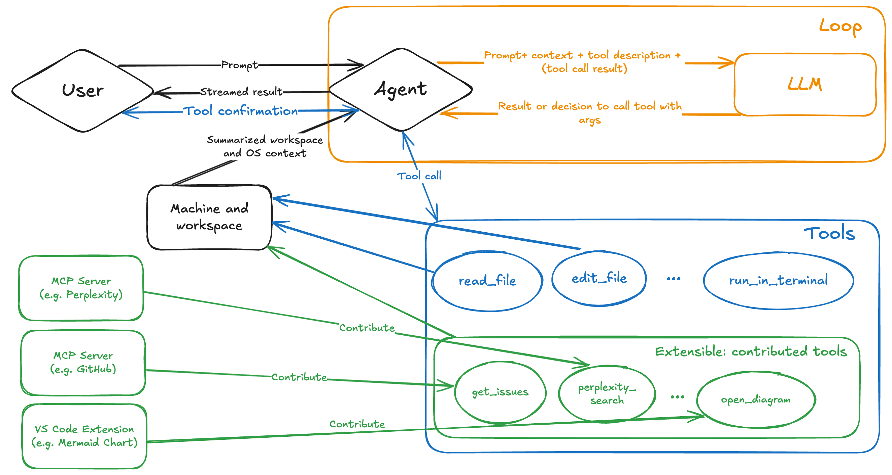

[← 上一课：代理模式][previous-lesson] · [下一课：自定义智能体 →][next-lesson]

你刚刚使用代理模式构建了筛选功能。创建拉取请求之前，应先确认该功能在浏览器中正常运行。此处将连接 **Playwright MCP 服务器**，让 Copilot 操作真实浏览器并测试功能，然后发布分支并创建 PR。

本练习将：

- 了解模型上下文协议 (MCP) 以及 MCP 服务器如何为 Copilot 扩展工具；
- 在工作区中添加 Playwright MCP 服务器；
- 让 Copilot 使用该服务器在浏览器中手动测试筛选功能；
- 发布分支，并为筛选功能创建拉取请求。

## 什么是模型上下文协议 (MCP)？

当代理模式可以访问编辑器之外的资源时，功能会更强大。模型上下文协议 (MCP) 是 Copilot 与外部工具和服务通信的标准方式。



[模型上下文协议 (MCP)](https://github.blog/ai-and-ml/llms/what-the-heck-is-mcp-and-why-is-everyone-talking-about-it/) 让 AI 智能体能够与外部工具和服务通信。通过 MCP，智能体可以实时访问最新信息（使用资源），并代表你执行操作（使用工具）。

MCP 服务器充当 AI 智能体与外部工具和服务之间的桥梁，负责管理通信。外部工具可以是现有 API，也可以是 npm 包等本地工具。每个 MCP 服务器都会提供一组智能体可以使用的工具和资源。

常见的 MCP 服务器包括：

- **[GitHub MCP Server](https://github.com/github/github-mcp-server)**：提供一组管理 GitHub 存储库的 API，让 AI 智能体创建存储库、更新内容、管理议题和拉取请求等。
- **[Playwright MCP Server](https://github.com/microsoft/playwright-mcp)**：使用 Playwright 提供浏览器自动化能力，让 AI 智能体访问网页、填写表单和选择按钮等。

还有许多 MCP 服务器提供不同工具和资源。GitHub 提供了 [MCP 注册表](https://github.com/mcp)，方便用户查找和贡献 MCP 项目。

> [!CAUTION]
> 安全方面应像对待项目其他依赖项一样对待 MCP 服务器。使用前，请仔细审查源代码、验证发布者并考虑安全影响。只使用可信的 MCP 服务器，谨慎授予其访问敏感资源或执行敏感操作的权限。

## 查看 MCP 配置

`.vscode/mcp.json` 文件配置了 VS Code 工作区可用的 MCP 服务器。

1. 在 codespace 中打开 `.vscode/mcp.json`。
2. 你会看到已经配置好的 `github` 服务器：

    ```json
    {
      "servers": {
        "github": {
          "type": "http",
          "url": "https://api.githubcopilot.com/mcp/"
        }
      }
    }
    ```

项目模板预先配置了 `github` 项，因此 Copilot 才能在上一课读取待办议题。它使用[远程 GitHub MCP 服务器][remote-github-mcp-server]，无需本地安装；VS Code 通过 HTTP 连接，并在 Copilot 首次使用其工具时使用 GitHub 进行身份验证。

## 添加 Playwright MCP 服务器

现在添加第二个服务器。[Playwright MCP 服务器][playwright-mcp-server]可以让 Copilot 操作浏览器，正好用于测试新功能。

1. 在 `.vscode/mcp.json` 中，在 `github` 旁添加 `playwright` 项，使文件如下所示：

    ```json
    {
      "servers": {
        "github": {
          "type": "http",
          "url": "https://api.githubcopilot.com/mcp/"
        },
        "playwright": {
          "command": "npx",
          "args": ["@playwright/mcp@latest", "--headless"]
        }
      }
    }
    ```

2. 保存文件。

与远程 `github` 服务器不同，`playwright` 是**本地**服务器：VS Code 会在你的计算机上运行 `npx @playwright/mcp@latest` 来启动它。`--headless` 标记让 Playwright 在后台运行浏览器，不显示窗口。codespace 中没有桌面环境，因此需要使用此模式。

> [!NOTE]
> Tailspin Toys 项目已在端到端测试中使用 Playwright，因此通常已经安装 Playwright 所需的浏览器。如果 Copilot 报告缺少浏览器，请让它运行 `npx playwright install chromium`，然后重试。

## 启动并信任服务器

VS Code 会在需要时启动 MCP 服务器。Copilot 首次需要服务器工具时，VS Code 会启动服务器并询问你是否信任它。

1. `.vscode/mcp.json` 中的 `playwright` 项上方会出现 **Start** 操作。选择它以立即启动服务器，并确认配置正确。
2. 如果 VS Code 询问是否信任服务器，请审查配置并选择信任，以便启动服务器。

手动启动是可选的。如果跳过此步骤，VS Code 会在下一步的 Copilot 首次需要服务器工具时启动服务器，并提示你确认是否信任。

## 测试筛选功能

[Playwright MCP 服务器][playwright-mcp-server]可以让 Copilot 操作真实浏览器。无需亲自逐项检查应用，智能体可以打开页面、导航、应用筛选条件并读取结果，然后向你总结观察到的情况。在不离开对话的情况下，就能快速确认功能是否符合预期。

Playwright MCP 服务器使用页面的[无障碍树][playwright-mcp-server]，而不是截图。这样智能体就能像辅助技术一样，根据带标签的结构化元素（按钮、链接和列表项）进行推理。因此，快速功能检查也可以顺便检查基本无障碍情况。

连接服务器并启动应用后，让 Copilot 测试刚完成的筛选功能：

```text
Using the Playwright MCP server, open a browser to the running app at http://localhost:4321 and verify the new game filtering feature:

1. Go to the games page and note how many games are listed.
2. Apply a category filter and confirm the list updates to only show games in that category.
3. Clear it, then apply a publisher filter and confirm the list updates to that publisher.
4. Combine a category and a publisher filter and confirm the results respect both.

Report what you observe at each step, and call out anything that does not behave as expected.
```

Copilot 会通过 Playwright MCP 服务器启动浏览器、逐步完成测试，并报告结果。根据议题中的验收标准审阅摘要；如果发现异常，可以继续提问，或让 Copilot 修复代码后再创建拉取请求。

> [!NOTE]
> 测试时应用必须运行在 `http://localhost:4321`。如果开发服务器已停止，请先重新启动，然后再发送提示。Copilot 首次使用 Playwright MCP 服务器时，可能需要下载浏览器；如果它报告缺少浏览器，请让它运行 `npx playwright install chromium` 并重试。

[playwright-mcp-server]: https://github.com/microsoft/playwright-mcp

## 发布分支并创建拉取请求

确认功能正常后，就可以创建拉取请求供团队审查。首先发布 `filtering-vscode` 分支。

1. 在 codespace 中打开 **Source Control** 面板，审查 Copilot 做出的更改。
2. 选择 **+** 图标暂存更改。
3. 使用 **Sparkle** 按钮生成提交消息。

   

4. 选择 **Publish**，将分支推送到存储库。

## 创建拉取请求

可以通过 github.com 或 GitHub 命令行界面 (CLI) 等方式创建拉取请求。也可以让 Copilot 查找相关议题并创建与议题关联的 PR。

1. 打开 Copilot Chat 面板，选择 **New Chat** 开始新会话。
2. 确认智能体下拉菜单中已选择 **Agent**，以便 Copilot 使用 GitHub 工具。
3. 发送以下提示，让 Copilot 创建 PR：

   ```plaintext
   Find the issue in the repo related to filtering by category and publisher. Create a new pull request for the current branch, and associate it with the correct issue.
   ```

4. 根据需要选择 **Continue**，允许 Copilot 收集信息并执行操作。首次使用 GitHub 工具时，系统可能会提示你进行 GitHub 身份验证；按照提示授权即可。
5. 查看 Copilot 如何搜索议题、找到正确的议题并创建 PR。
6. 选择 Copilot 生成的链接查看拉取请求，但**暂时不要合并**。

## 总结与后续步骤

本练习中，你：

- 了解了模型上下文协议 (MCP) 以及 MCP 服务器如何为 Copilot 扩展工具；
- 在工作区中添加了 Playwright MCP 服务器；
- 使用该服务器在浏览器中手动测试筛选功能；
- 发布了分支，并为筛选功能创建了拉取请求。

你刚刚使用 MCP 服务器测试了功能，但 MCP 只是扩展 Copilot 的一种方式。下一步，创建[自定义智能体][next-lesson]，帮助处理无障碍审查等特定任务。

## 资源

- [MCP 是什么？为何大家都在讨论它？][mcp-blog-post]
- [Microsoft Playwright MCP 服务器][playwright-mcp-server]
- [GitHub MCP 服务器][github-mcp-server]
- [GitHub MCP 注册表][mcp-registry]
- [VS Code 中的 MCP 服务器][vscode-mcp-config]

[previous-lesson]: ../2-agent-mode/
[next-lesson]: ../4-custom-agents/
[mcp-blog-post]: https://github.blog/ai-and-ml/llms/what-the-heck-is-mcp-and-why-is-everyone-talking-about-it/
[github-mcp-server]: https://github.com/github/github-mcp-server
[mcp-registry]: https://github.com/mcp
[remote-github-mcp-server]: https://github.blog/changelog/2025-06-12-remote-github-mcp-server-is-now-available-in-public-preview/
[vscode-mcp-config]: https://code.visualstudio.com/docs/agents/reference/mcp-configuration
